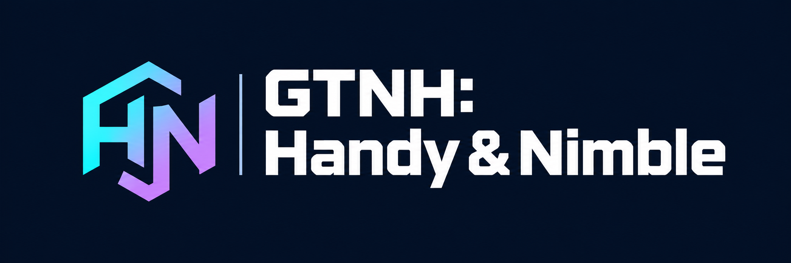

> Ported, developed and integrated by **GPT-6 (Codex)**.

**GTNH-HN** · Handy & Nimble

[简体中文](README.md) · **English** · [Releases](https://github.com/arturia-Xayah/gtnh-hn/releases)

Minecraft **1.7.10** · GTNH **2.9.1**

**GTNH-HN** is a lightweight collection of practical additions and quality-of-life improvements for **GT New Horizons**. It makes everyday multiblock building, AE pattern and crafting work, machine power control, storage and travel easier to manage.

**[User guide](docs/wiki/README.en.md)** · [Download JAR](https://github.com/arturia-Xayah/gtnh-hn/releases/download/v0.4.2-GTNH-2.9.1/gtnh-hn-0.4.2-GTNH-2.9.1.jar) · [Changelog](CHANGELOG.md)

## Contents

| Category | Features and guides |
| --- | --- |
| [Installation and updates](docs/wiki/README.en.md#installation-and-updates) | [Installation and upgrading](docs/wiki/en/installation.md) · [Client updates](docs/wiki/en/updates.md) |
| [Building and machine controls](docs/wiki/README.en.md#building-and-machine-controls) | [Advanced Structure Terminal](docs/wiki/en/structure-terminal.md) · [BuildCraft work range](docs/wiki/en/buildcraft-range.md) · [Forge and fusion power controls](docs/wiki/en/power-controls.md) |
| [AE networks and automation](docs/wiki/README.en.md#ae-networks-and-automation) | [Craftable input badges](docs/wiki/en/craftable-inputs.md) · [Integrated Pattern](docs/wiki/en/integrated-patterns.md) · [ME Packing Tape](docs/wiki/en/packing-tape.md) · [AE order optimization](docs/wiki/en/ae-ordering.md) · [ME Advanced Level Emitter](docs/wiki/en/level-emitter.md) · [Dual ME Stocking Input Bus](docs/wiki/en/dual-input-bus.md) · [Dual ME Output Bus](docs/wiki/en/dual-output-bus.md) |
| [ME storage](docs/wiki/README.en.md#me-storage) | [ME Cell Aggregation Storage](docs/wiki/en/storage.md) · [Read-cache settings](docs/wiki/en/storage-cache.md) |
| [Portals and scenes](docs/wiki/README.en.md#portals-and-scenes) | [Portal Projector](docs/wiki/en/portal-projector.md) |
| [Compatibility and configuration](docs/wiki/README.en.md#compatibility-and-configuration) | [Compatibility and configuration](docs/wiki/en/compatibility.md) |
| [Project resources](docs/wiki/README.en.md#project-resources) | [Changelog](CHANGELOG.md) · [Developer docs](docs/development/README.md) · [License](LICENSE) · [Credits](THIRD_PARTY_NOTICES.md) |

## Quick installation

Current version: **0.4.2**, for **GTNH 2.9.1 / Minecraft 1.7.10**.

1. Download the JAR for your GTNH version from [Releases](https://github.com/arturia-Xayah/gtnh-hn/releases) and place it in `mods`. Multiplayer clients and servers need the same version.
2. Replace the previous merged mod JAR and remove duplicate standalone AE Order Optimizer, Plasma Forge Power and AE Storage Vault JARs.
3. Back up the whole world before upgrading. **Export inventory from 0.2.x vaults first**, then follow the [migration instructions](docs/wiki/en/installation.md).

GTNH Modernization Upgrade is now **GTNH-HN**. Install a renamed build manually once. Dependencies come from the target GTNH pack. See [Installation](docs/wiki/en/installation.md) and [In-game updates](docs/wiki/en/updates.md) for the full steps.

## Documentation

Detailed controls, settings and compatibility notes are collected in the [user guide](docs/wiki/README.en.md). Build steps, implementation details, experiments and verification records are kept in [developer documentation](docs/development/README.md).
